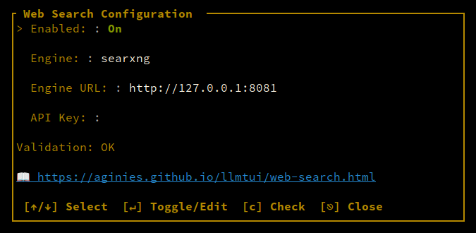

# Web Search

llm-manager can automatically search the web when your chat messages contain research-oriented keywords. Results are fetched from a pluggable search engine — a self-hosted [SearXNG](https://github.com/searxng/searxng) instance or the hosted **Searlo** API — and injected into the prompt before your message, allowing the LLM to cite sources and provide up-to-date information.

## Server-Side Flow

Web search runs **entirely on the llm-manager server**. External clients (chat frontends, curl, etc.) connect to llm-manager's API proxy (default port `49222`) just like any other chat request — no special headers or endpoints needed. The server intercepts chat completions requests, checks for search keywords, performs the web search, injects the results into the prompt, and forwards the enriched request to llama-server.

```
┌──────────┐     /v1/chat/completions      ┌──────────────────┐
│  Client  │ ──────────────────────────────►│ llm-manager API  │
│ (curl,   │ ◄──────────────────────────────│ proxy (port 49222)│
│  UI, etc)│     SSE streaming response     └────────┬─────────┘
└──────────┘                                        │
                                                    │ triggers search
                                                    ▼
                                           ┌──────────────────┐
                                           │   SearXNG /      │
                                           │   Searlo         │
                                           └──────────────────┘
```

The `web_search_engine_url` config points to the **search engine** (SearXNG instance or Searlo API base), not the client. Clients never need direct access to the engine — they only talk to llm-manager's API proxy.

## Trigger

Web search triggers when your message contains `$web`:

```
$web best model for coding 2026
$web compare qwen 3 and llama 4
$web recommend vision model
```

`$web` must appear as a standalone token — `webui` or `$webui` does not trigger a search.

## Configuration

### Via Server Settings Panel

1. Open the **Server Settings** panel (press `F2` or `l` when focused)
2. Navigate to the **Web Search** field using arrow keys
3. Press `↵` (Enter) to open the Web Search Picker dialog

The dialog (65 columns wide, 15 rows tall) shows:

| Field | Type | Description |
|-------|------|-------------|
| **Enabled** | Toggle | Shows "On" (green) or "Off" (gray) — press `↵` to toggle |
| **Engine** | Dropdown | Search engine: `searxng` or `searlo` |
| **Engine URL** | Text input | SearXNG instance URL (e.g., `https://search.example.com`). For `searlo`, auto-filled with the default API base (`https://api.searlo.tech/api/v1`) — leave it as-is unless you have a different base |
| **API Key** | Text input | Searlo: your Searlo API key (**required**). SearXNG: optional Bearer token. Masked as `****` when set |

Navigation: `↑`/`↓` (or `j`/`k`) to move between fields, `↵` to toggle/edit, `⎋` (Esc) to close. Press `c` on the **Enabled** field to re-run the engine health check manually.

Selecting `searlo` in the Engine dropdown auto-fills the Engine URL with Searlo's default base URL. Toggling **Enabled** on runs a health check against the configured engine and shows the result in the dialog.

### Via config.yaml

Add these fields to your `~/.config/llm-manager/config.yaml`:

```yaml
# SearXNG (self-hosted instance)
default:
  web_search_enabled: true
  web_search_engine: searxng
  web_search_engine_url: "https://search.example.com"
  web_search_api_key: null  # optional, omit or set to null if not needed
```

```yaml
# Searlo (hosted API)
default:
  web_search_enabled: true
  web_search_engine: searlo
  web_search_engine_url: "https://api.searlo.tech/api/v1"  # optional — this default is used when empty
  web_search_api_key: "your-searlo-api-key"  # required for searlo
```

### Per-Model Override

Web search settings can also be configured per-model in `~/.config/llm-manager/models/<model_name>.yaml`:

```yaml
web_search_enabled: true
web_search_engine: searxng
web_search_engine_url: "https://search.example.com"
web_search_api_key: null
```

Model-level settings override the global defaults.

## How It Works

When a message matches a trigger keyword:

1. **Query extraction** — the full user message is used as the search query
2. **Engine search** (only when the message contains `$web`) — SearXNG: `GET {engine_url}/search?q={query}&format=json`; Searlo: `GET {base}/search/web?q={query}&limit=10&toon=true` (see [Request Details](#request-details))
3. **URL extraction** — URLs explicitly marked as `$furl <url>` (one per line, case-insensitive) are collected for page fetching — up to 5, deduplicated. Bare URLs elsewhere in the message are ignored on purpose, so incidental links never trigger web-context injection
4. **Concurrent gathering** — the engine search and the URL page-fetching run as separate tasks in parallel, both bounded by the 15-second timeout
5. **Result parsing** — SearXNG: JSON with a `results` array; each result needs `title`, `url`, and `content`/`snippet`. Searlo: JSON with an `organic` array; each result needs `title`, `link`, and `snippet`/`description`/`content`. Searlo may also return a compact `toon` rendering (see [TOON](#toon-token-optimized-object-notation))
6. **Page fetching** — Wikipedia results and up to 5 other URLs have their page content fetched in parallel
7. **Context injection** — results are prepended to the message as a `[WEB CONTEXT]...[END WEB CONTEXT]` block

## Concurrent Fetching & SSRF Protection

Fetching page content from arbitrary URLs in a message is powerful but risky: a malicious link could point at an internal service (e.g. a cloud metadata endpoint or an intranet server). To prevent this, every URL is validated before fetching:

- **Scheme check** — only `http` and `https` are allowed
- **DNS resolution + IP block list** — the hostname is resolved and **every** resolved IP is checked. Addresses in blocked ranges are rejected:
  - loopback (`127.0.0.0/8`, `::1`)
  - private (`10.0.0.0/8`, `172.16.0.0/12`, `192.168.0.0/16`, `fc00::/7`)
  - link-local / cloud metadata (`169.254.0.0/16`)
  - unspecified (`0.0.0.0`, `::`)
  - IPv4-mapped addresses are decoded and checked as v4

If any resolved IP is blocked, the URL is skipped with a logged warning rather than fetched. Pages that come back too short (likely blocked or empty) or are blocked by Cloudflare / a security filter are also skipped and counted. The engine search and the URL fetch run concurrently, so adding URLs does not wait for (or block) a `$web` search and vice versa.

### Request Details

**SearXNG**

- **Endpoint:** `{engine_url}/search?q={url_encoded_query}&format=json`
- **User-Agent:** `Mozilla/5.0 (X11; Linux x86_64) AppleWebKit/537.36 (KHTML, like Gecko) Chrome/120.0.0.0 Safari/537.36`
- **Authentication:** `Authorization: Bearer {api_key}` header (only if `api_key` is configured)
- **Timeout:** 15 seconds
- **Max results:** 10

**Searlo**

- **Endpoint:** `{base}/search/web?q={url_encoded_query}&limit=10&toon=true`
- **Base URL:** the `web_search_engine_url` value; when empty, falls back to `https://api.searlo.tech/api/v1`
- **Authentication:** `x-api-key: {api_key}` header — **required**; without an API key the Searlo search is skipped entirely
- **User-Agent:** `Mozilla/5.0 (X11; Linux x86_64) AppleWebKit/537.36 (KHTML, like Gecko) Chrome/120.0.0.0 Safari/537.36`
- **Timeout:** 15 seconds
- **Max results:** 10

### TOON (Token-Optimized Object Notation)

The `toon=true` parameter asks Searlo to include a compact `toon` rendering of the results alongside the JSON. When present, it is injected into the prompt instead of the markdown result list — it costs roughly 60% fewer tokens, which matters when the context is precious. SearXNG has no TOON equivalent; the markdown list is used there.

### Injected Prompt Format

The web context is prepended to the user message like this:

```
[WEB CONTEXT]
INSTRUCTION: Cite sources using inline markdown links in your answer.

## Search Results
1. **Title** - URL
   snippet text

## Web Context
## [Title](URL)
...fetched page content...

[END WEB CONTEXT]

[Original user message]
```

For Searlo, the `## Search Results` block contains the engine's TOON rendering instead of the numbered markdown list.

## Engine Support

| Engine | Status | Notes |
|--------|--------|-------|
| **SearXNG** | ✅ Fully functional | Self-hosted; requires `engine_url` pointing to a SearXNG instance |
| **Searlo** | ✅ Fully functional | Hosted API; requires `api_key`; `engine_url` optional (defaults to `https://api.searlo.tech/api/v1`) |

## Searlo Setup

Searlo is a hosted search API — there is no server to run. You only need an API key:

1. Create an account on the Searlo website and copy your API key.
2. Open the **Server Settings** panel → **Web Search** field → `↵`
3. Set **Engine** to `searlo` — the **Engine URL** is auto-filled with `https://api.searlo.tech/api/v1` (leave it unless you have a different base)
4. Paste your key into **API Key**
5. Toggle **Enabled** on — a health check (`GET {base}/search/web?q=test&limit=1` with the `x-api-key` header) runs and reports success/failure in the dialog

Or configure it directly in `config.yaml` (see [Configuration](#configuration)).

## SearXNG Setup (self-hosted)



### Minimal `settings.yml`

SearXNG requires a `settings.yml` configuration file. Create one before deploying:

```yaml
use_default_settings: true

server:
  secret_key: "change-this-to-a-random-secret"  # generate with: python3 -c "import secrets; print(secrets.token_hex(32))"
  port: 8081
  bind_address: "0.0.0.0"
  # Base URL — required to avoid 303 redirects
  # Set to the public URL where SearXNG is accessible
  base_url: "http://localhost:8081"  # or "https://search.example.com"

search:
  default_lang: en
  # Enable JSON format for API access (required for llm-manager web search)
  formats:
    - html
    - json
```

> **Note:** The `server.port` in `settings.yml` is for SearXNG's WSGI metadata. The actual listening port is controlled by the `GRANIAN_PORT` environment variable (default `8080`). You must set `-e GRANIAN_PORT=8081` to match your desired port.

### Podman (standalone)

Run SearXNG as a standalone Podman container:

```bash
# Create config directory and settings file
mkdir -p ~/.searxng
cat > ~/.searxng/settings.yml << 'EOF'
use_default_settings: true

server:
  secret_key: "change-this-to-a-random-secret"
  port: 8081
  bind_address: "0.0.0.0"
  base_url: "http://localhost:8081"  # uncomment if behind reverse proxy

search:
  default_lang: en
  formats:
    - html
    - json
EOF

# Run the container
podman run -d \
  --name searxng \
  -p 8081:8081 \
  -e GRANIAN_PORT=8081 \
  -v ~/.searxng/settings.yml:/etc/searxng/settings.yml:Z \
  --restart unless-stopped \
  searxng/searxng:latest
```

> **Important:** Do **not** use `-v ~/.searxng:/etc/searxng/lib/searx:Z` — it replaces the entire Python package directory with an empty directory, causing the container to crash. Only mount the `settings.yml` file.

After deployment, use `http://localhost:8081` (or your public URL) as the Engine URL in llm-manager.

### Docker Compose

For Docker Compose users, create `docker-compose.yml`:

```yaml
services:
  searxng:
    image: searxng/searxng:latest
    ports:
      - "8081:8081"
    environment:
      - GRANIAN_PORT=8081
    volumes:
      - ~/.searxng/settings.yml:/etc/searxng/settings.yml:Z
    restart: unless-stopped
```

Run with:

```bash
docker compose up -d
```

### podman-compose

For `podman-compose` users:

```yaml
services:
  searxng:
    image: searxng/searxng:latest
    ports:
      - "8081:8081"
    environment:
      - GRANIAN_PORT=8081
    volumes:
      - ~/.searxng/settings.yml:/etc/searxng/settings.yml:Z
    restart: unless-stopped
```

Run with:

```bash
podman-compose up -d
```

## Settings Panel Display

The Server Settings panel shows the current web search status with the active engine:

```
Web Search: Enabled (searxng)
Web Search: Enabled (searlo)
Web Search: Disabled (searlo)
```

When web search is enabled, the status bar also shows the engine next to the server status (e.g. `[49222 Normal] SEARLO`).

## Troubleshooting

- **303 redirect** — set `server.base_url` in `settings.yaml` to the public URL (e.g., `http://localhost:8081` or `https://search.example.com`)
- **Search returns no results** — verify the Engine URL is accessible and points to a running SearXNG instance
- **Timeout errors** — web search has a 15-second timeout; slow SearXNG instances may need tuning
- **Authentication failures** — if `web_search_api_key` is set, ensure the SearXNG instance accepts the Bearer token
- **Results not appearing in chat** — check that trigger keywords are present in the message
- **Searlo 401/403** — the API key is missing or invalid; Searlo requires a valid `web_search_api_key`
- **Searlo no results** — check the key's quota/plan, and that the Engine URL is the API base (ends in `/api/v1`)
- **HTTPS certificate errors** — ensure the SearXNG instance has valid TLS certificates if using `https://`
